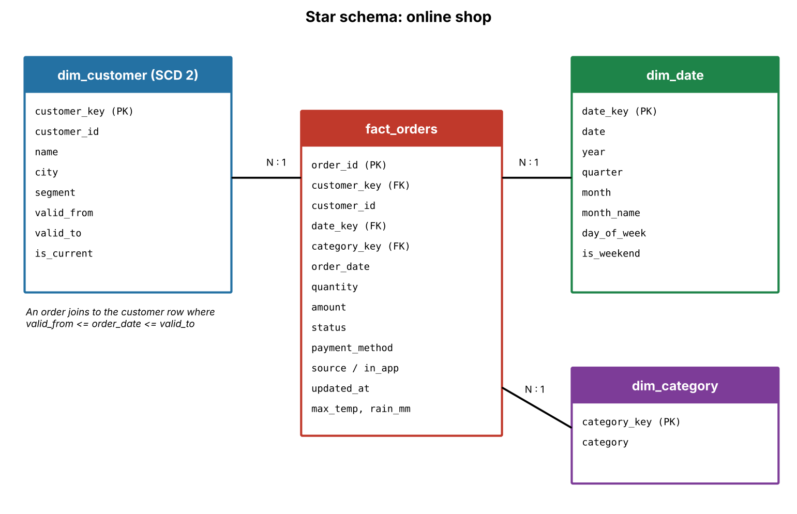

# online-shop-etl-pipeline

# online-shop-etl-pipeline

## What I built
A pipeline for an online shop: PostgreSQL (web orders), MongoDB (app orders) and the Open-Meteo weather API are extracted and cleaned in Google Colab, modelled as a star schema, stored as Delta tables in Databricks, processed with Spark into gold tables, and used to train a churn model tracked with MLflow.

## Part 1: Extraction
- customers (PostgreSQL): 2,000 rows
- orders (PostgreSQL, read in 50,000-row chunks): 200,000 rows
- orders (MongoDB): 5,000 documents
- weather (Open-Meteo): one file each for Lahore, Karachi and Islamabad
- Incremental extract with last_run = 2026-10-01: 8,593 rows

## Part 2: Cleaning
**Duplicate rule:** all 5,000 app orders also exist in PostgreSQL. I keep one row per order_id: the one with the latest updated_at, and the web row if they tie. The app city is kept in app_city, and in_app marks orders that came through the app.

**Data quality checks:**
- No null order_id: PASS
- order_id is unique: PASS
- amount > 0: PASS
- Every customer_id exists in customers: PASS
- No order dated in the future: PASS
- Status is one of the 5 known values: PASS
- quantity >= 1: PASS

## Part 3: Star schema

fact_orders is linked to dim_customer (SCD Type 2), dim_date (2025-01-01 to 2026-12-31) and dim_category. An order joins to the customer row where valid_from <= order_date <= valid_to.

Example: customer 5 moved from Quetta to Karachi on 2026-04-15, so an order from February 2026 joins to the Quetta row.

## Part 4: Delta tables
fact_orders version 0 has 197,153 rows. After merging the orders updated after 2026-10-20, it has 200,000 rows (+2,847). The history shows the creates and the merge.

(paste the DESCRIBE HISTORY screenshot here)

## Part 5: Gold tables and answers
Revenue and average order value exclude cancelled and returned orders. City comes from dim_customer (the city at the time of the order).

1. **Which city grew fastest in 2026?** Lahore, with 6.7% more revenue in Jan to Sep 2026 than in Jan to Sep 2025.

2. **Fewer orders on rainy days?** No. Lahore, Karachi and Islamabad get about the same number of orders on rainy and dry days (Lahore 65.1 vs 64.8, Karachi 77.7 vs 76.3, Islamabad 33.7 vs 33.5 orders per day), so rain does not reduce orders.

3. **Highest average order value?** Electronics, at about 78,494.

## Part 6: Churn model
Cutoff 2026-08-01. Features use only orders before the cutoff, so there is no leakage. A customer is churned if they placed no order from 2026-08-01 to 2026-10-24.

With this cutoff only about 2 of 2,000 customers churned, so recall, precision and f1 were 0 for all three models, and accuracy was misleading.

As an extra experiment I reran with a cutoff of 2026-10-01 (about 12% of customers churned). I chose the logreg model, with recall 0.72 and precision 0.17. I chose it for its recall, because for a win-back campaign it costs more to miss a customer who is leaving than to send an offer to one who would have stayed. Precision is low, so many customers flagged would not have left, but sending them an offer costs little.

I reloaded the chosen model by its run ID and scored 5 customers.

# online-shop-etl-pipeline

## What I built
A pipeline for an online shop: PostgreSQL (web orders), MongoDB (app orders) and the Open-Meteo weather API are extracted and cleaned in Google Colab, modelled as a star schema, stored as Delta tables in Databricks, processed with Spark into gold tables, and used to train a churn model tracked with MLflow.

## Part 1: Extraction
- customers (PostgreSQL): 2,000 rows
- orders (PostgreSQL, read in 50,000-row chunks): 200,000 rows
- orders (MongoDB): 5,000 documents
- weather (Open-Meteo): one file each for Lahore, Karachi and Islamabad
- Incremental extract with last_run = 2026-10-01: 8,593 rows

## Part 2: Cleaning
**Duplicate rule:** all 5,000 app orders also exist in PostgreSQL. I keep one row per order_id: the one with the latest updated_at, and the web row if they tie. The app city is kept in app_city, and in_app marks orders that came through the app.

**Data quality checks:**
- No null order_id: PASS
- order_id is unique: PASS
- amount > 0: PASS
- Every customer_id exists in customers: PASS
- No order dated in the future: PASS
- Status is one of the 5 known values: PASS
- quantity >= 1: PASS

## Part 3: Star schema

fact_orders is linked to dim_customer (SCD Type 2), dim_date (2025-01-01 to 2026-12-31) and dim_category. An order joins to the customer row where valid_from <= order_date <= valid_to.

Example: customer 5 moved from Quetta to Karachi on 2026-04-15, so an order from February 2026 joins to the Quetta row.

## Part 4: Delta tables
fact_orders version 0 has 197,153 rows. After merging the orders updated after 2026-10-20, it has 200,000 rows (+2,847). The history shows the creates and the merge.

(paste the DESCRIBE HISTORY screenshot here)

## Part 5: Gold tables and answers
Revenue and average order value exclude cancelled and returned orders. City comes from dim_customer (the city at the time of the order).

1. **Which city grew fastest in 2026?** Lahore, with 6.7% more revenue in Jan to Sep 2026 than in Jan to Sep 2025.

2. **Fewer orders on rainy days?** No. Lahore, Karachi and Islamabad get about the same number of orders on rainy and dry days (Lahore 65.1 vs 64.8, Karachi 77.7 vs 76.3, Islamabad 33.7 vs 33.5 orders per day), so rain does not reduce orders.

3. **Highest average order value?** Electronics, at about 78,494.

## Part 6: Churn model
Cutoff 2026-08-01. Features use only orders before the cutoff, so there is no leakage. A customer is churned if they placed no order from 2026-08-01 to 2026-10-24.

With this cutoff only about 2 of 2,000 customers churned, so recall, precision and f1 were 0 for all three models, and accuracy was misleading.

As an extra experiment I reran with a cutoff of 2026-10-01 (about 12% of customers churned). I chose the logreg model, with recall 0.72 and precision 0.17. I chose it for its recall, because for a win-back campaign it costs more to miss a customer who is leaving than to send an offer to one who would have stayed. Precision is low, so many customers flagged would not have left, but sending them an offer costs little.

